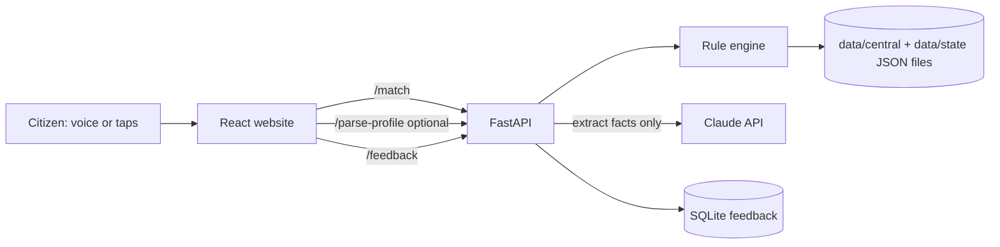

# Sahaya Setu

A voice-first, multilingual assistant that tells people which government schemes they qualify for, which documents they
are missing, and what to do next. **Andhra Pradesh is live; Telangana is in beta; any state can be added with data files
only.** Built for Zeta Innovate.

> Guidance only. Always confirm on the official website before applying.

## Features
- Students, women and farmers: scholarships and fee reimbursement, maternity benefit, free bus travel, farmer income support
- Telugu, Hindi and English interface; **speak your answers**, **read aloud**, or describe yourself in your own words (optional AI)
- Eligible, "needs one more answer" (it asks the missing question), and not-eligible groups, each with documents, steps, official link and last-checked date
- Annual benefit total, WhatsApp share, print
- Anonymous feedback and aggregate stats for impact numbers
- Rules decide eligibility; AI never does

## Architecture


## Run locally
Backend:
```bash
cd backend
python -m venv .venv && source .venv/bin/activate   # Windows: .venv\Scripts\activate
pip install -r requirements.txt
uvicorn app.main:app --reload
```
Website (needs Node.js 18+), in a second terminal:
```bash
cd frontend
npm install
npm run dev
```
Open http://localhost:5173. Optional: set `ANTHROPIC_API_KEY` before starting the backend to enable "describe yourself".

## Test
```bash
python scripts/validate_data.py
cd backend && python -m pytest -q
cd ../frontend && npm test
```

## Add a state
1. Add an entry to `data/states.json`.
2. Create `data/<code>/` with one JSON file per scheme (copy an existing one, include official `sources`).
3. Run `python scripts/validate_data.py`. No code changes needed.

## Deploy
See [docs/DEPLOY.md](docs/DEPLOY.md). Demo script: [docs/DEMO_SCRIPT.md](docs/DEMO_SCRIPT.md). Data sources: [docs/SOURCES.md](docs/SOURCES.md).

## Limits
Scheme text is English only; some rules are marked "confirm on the official website"; voice quality depends on the device's
Telugu/Hindi voices; free hosting sleeps when idle.
